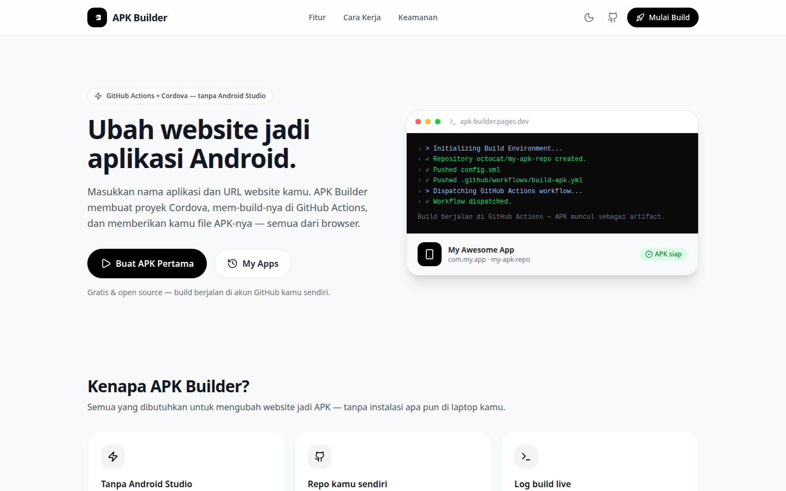
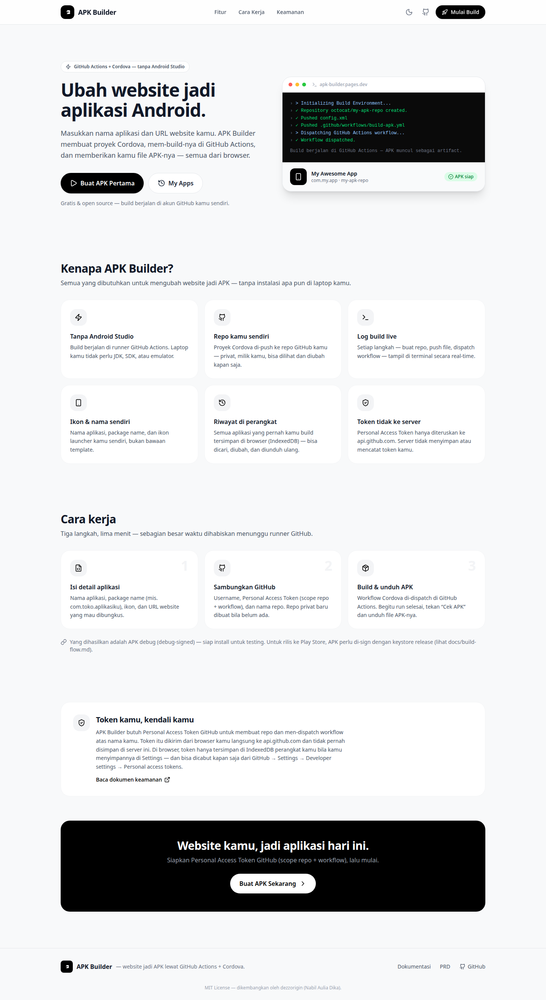
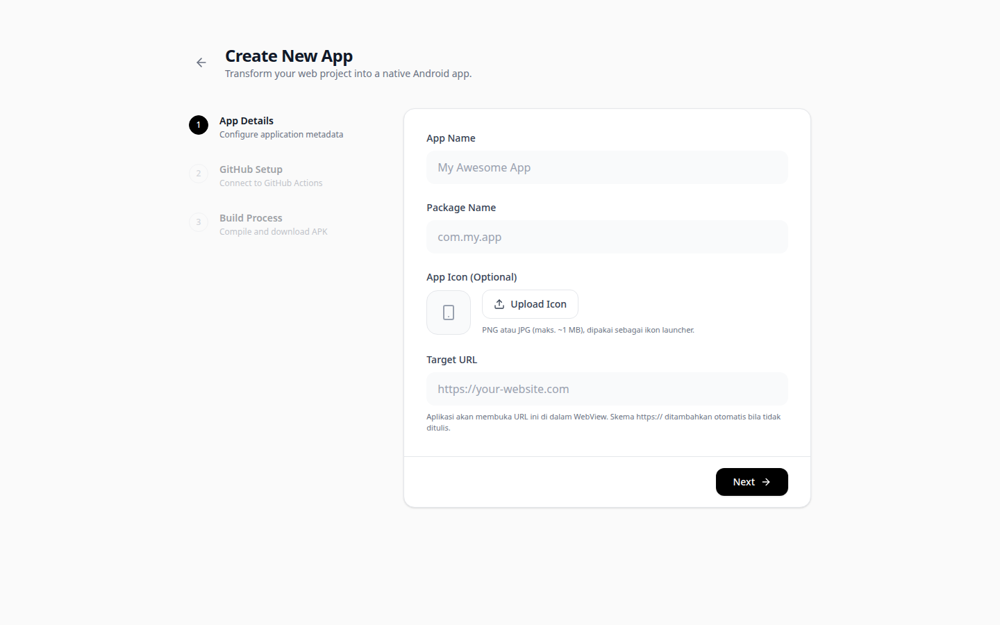
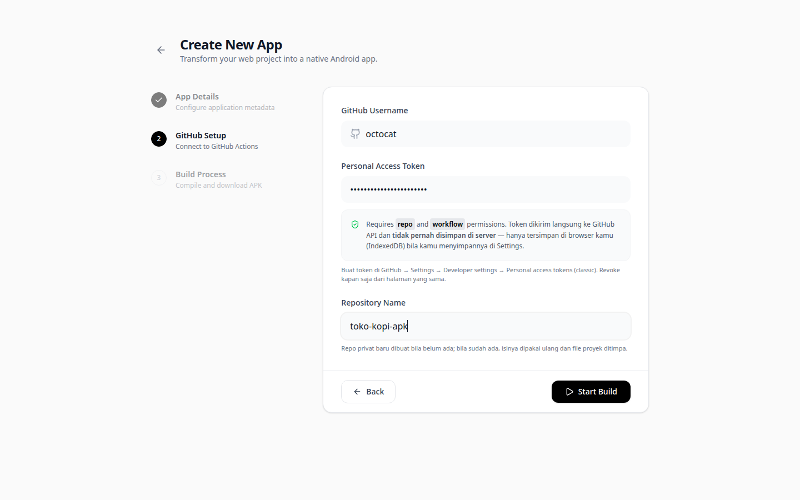
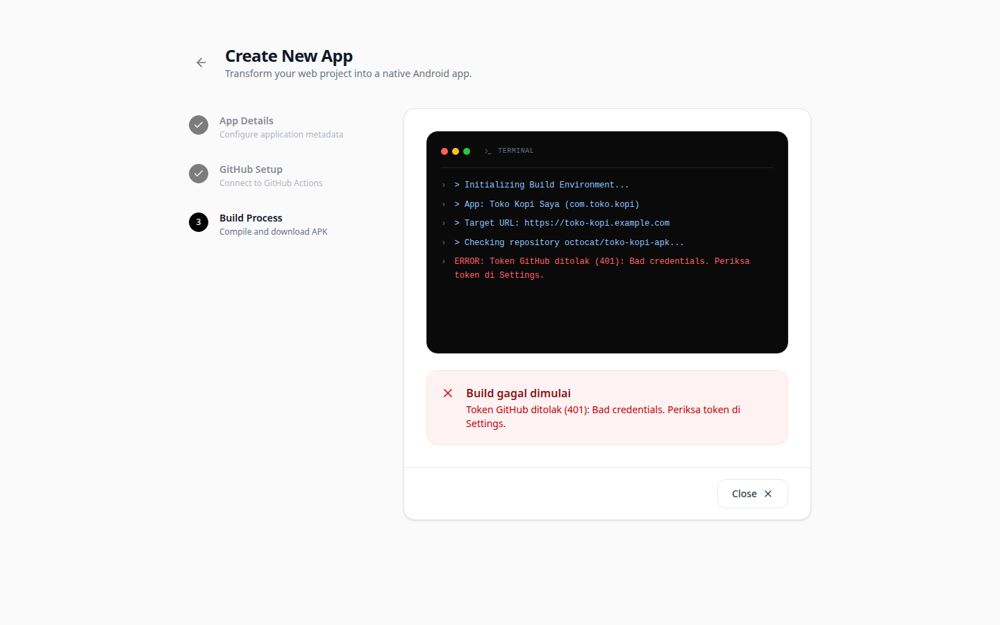
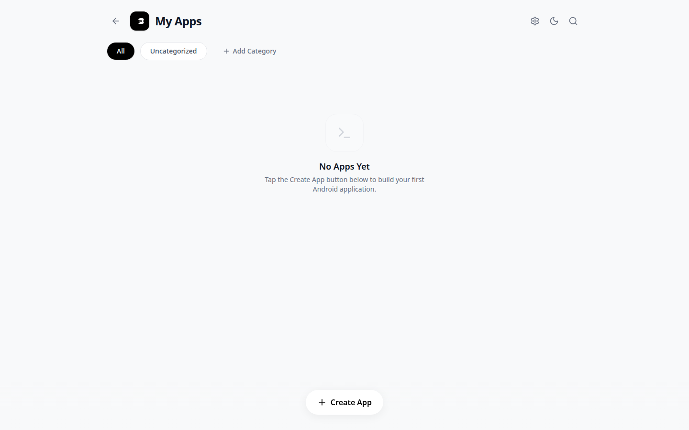
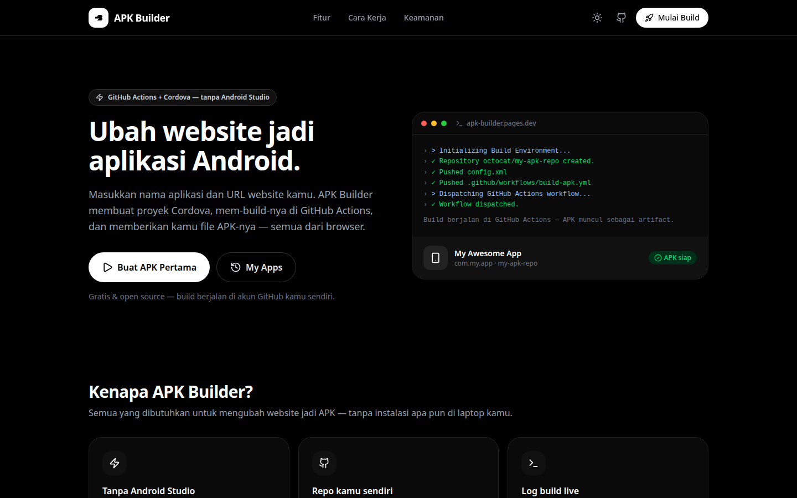

# APK Builder

**Ubah website jadi aplikasi Android (APK) — tanpa Android Studio.**

Masukkan nama aplikasi dan URL website kamu. APK Builder membuat proyek
Cordova, mem-build-nya di **GitHub Actions** (di repo GitHub kamu
sendiri), dan memberikan kamu file APK-nya — semua dari browser.

🌐 **Live demo: https://apk-builder.pages.dev**
📦 **Repo: https://github.com/dezzorigin/apk-builder**



> Video demo (11 detik, walkthrough asli: landing → wizard → build →
> dashboard):
>
> <video src="docs/demo/demo.mp4" controls width="100%"></video>

## Cara kerja

```
Browser (isi form 3 langkah)
  → Pages Worker: POST /api/build (SSE)
  → GitHub API: buat repo privat → push proyek Cordova → dispatch workflow
  → GitHub Actions: cordova build android --debug
  → "Cek APK" → artifact app-debug.apk → unduh
```

Diagram lengkap: [`docs/diagram.svg`](docs/diagram.svg) ·
Penjelasan langkah demi langkah: [`docs/build-flow.md`](docs/build-flow.md)

**Kalimat jujurnya:** repo ini tidak meng-compile Android apa pun
sendiri — GitHub Actions yang melakukannya. Dan justru itu cerita
menariknya: CI-nya adalah fitur produknya. Sebelum v1.1.0, produk ini
bahkan tidak bisa build sama sekali karena `POST /api/build` yang
dipanggil frontend **tidak pernah ada** di repo (hanya `/api/download`
yang ada). Lihat [`CHANGELOG.md`](CHANGELOG.md).

## Fitur

- **Wizard 3 langkah** — App Details (nama, package, ikon, URL) →
  GitHub Setup (username, token, repo) → Build Process (terminal log live).
- **Log build live (SSE)** — tiap langkah worker tampil di terminal,
  bukan spinner buta.
- **Tombol "Cek APK"** — memeriksa run GitHub Actions terakhir;
  begitu artifact jadi, APK langsung terunduh.
- **Riwayat di perangkat** — semua aplikasi yang pernah di-build
  tersimpan di IndexedDB: cari, ubah nama/ikon, hapus, unduh ulang.
- **PWA** — bisa di-install, manifest + service worker.
- **Tema terang/gelap.**

## Yang dihasilkan

`app-debug.apk` — APK debug (debug-signed), siap install untuk testing
di perangkat Android. **Bukan** APK release Play Store (butuh signing
keystore — sengaja di luar ruang lingkup; lihat
[`docs/build-flow.md`](docs/build-flow.md)).

## Yang kamu butuhkan

Satu hal: **Personal Access Token GitHub (classic)** dengan scope
`repo` + `workflow`. Buat di GitHub → Settings → Developer settings →
Personal access tokens. Token dikirim langsung ke `api.github.com` dan
**tidak pernah disimpan di server** — hanya di browser kamu (IndexedDB)
bila kamu menyimpannya di Settings. Detail lengkap:
[`docs/security.md`](docs/security.md).

## Menjalankan lokal

```bash
npm install
npm run build      # static export + copy worker ke out/
npm run serve      # http://127.0.0.1:8330/ (out/ + Pages Worker)
```

> `npm run dev` hanya menjalankan frontend — `/api/*` akan 404 di sana.
> Untuk menguji API, selalu `npm run build && npm run serve`.

Perintah lain:

```bash
npm test           # 18 unit test worker (GitHub API di-mock)
npm run typecheck  # tsc --noEmit
npm run lint       # eslint .
```

## Screenshot

| Landing | Wizard — App Details |
|---|---|
|  |  |

| Wizard — GitHub Setup | Build — error token ditolak (401) |
|---|---|
|  |  |

| Dashboard | Landing — dark mode |
|---|---|
|  |  |

Screenshot diambil dari sistem yang sedang berjalan (lokal, lalu
di-deploy identik ke live) — play-test 12/12 lolos, lihat
[`docs/development.md`](docs/development.md).

## API

| Rute | Deskripsi |
|---|---|
| `POST /api/build` | Mulai build (SSE): buat/cek repo → push template Cordova → dispatch workflow |
| `GET /api/artifact?user&repo&token` | Cari artifact APK run sukses terakhir |
| `GET /api/download?user&repo&artifact&token` | Proxy unduhan artifact (zip) |

Dokumentasi lengkap: [`docs/api.md`](docs/api.md)

## Struktur proyek

```
app/                  Next.js (landing + dashboard + wizard)
lib/db.ts             IndexedDB: riwayat + settings
public/cordova-template/  template Cordova (config.xml, package.json,
                          www/index.html, build-apk.yml)
worker/_worker.js     Pages Worker: /api/build, /api/artifact, /api/download
worker/_worker.test.mjs
scripts/              serve-worker.mjs, smoke.mjs, advisory-sweep.py
docs/                 arsitektur, api, build-flow, security, development,
                      deployment, diagram.svg, screenshots/, demo/
```

Arsitektur: [`docs/architecture.md`](docs/architecture.md) ·
Development: [`docs/development.md`](docs/development.md) ·
Deployment: [`docs/deployment.md`](docs/deployment.md) ·
PRD: [`PRD.md`](PRD.md)

## Tech stack

Next.js 15 (static export) · React 19 · Tailwind CSS 4 · Cloudflare
Pages + Pages Worker · Cordova 12 / cordova-android 13 · GitHub Actions

## Lisensi

MIT — lihat [LICENSE](./LICENSE). Dikembangkan oleh **dezzorigin**
(Nabil Aulia Dika).
